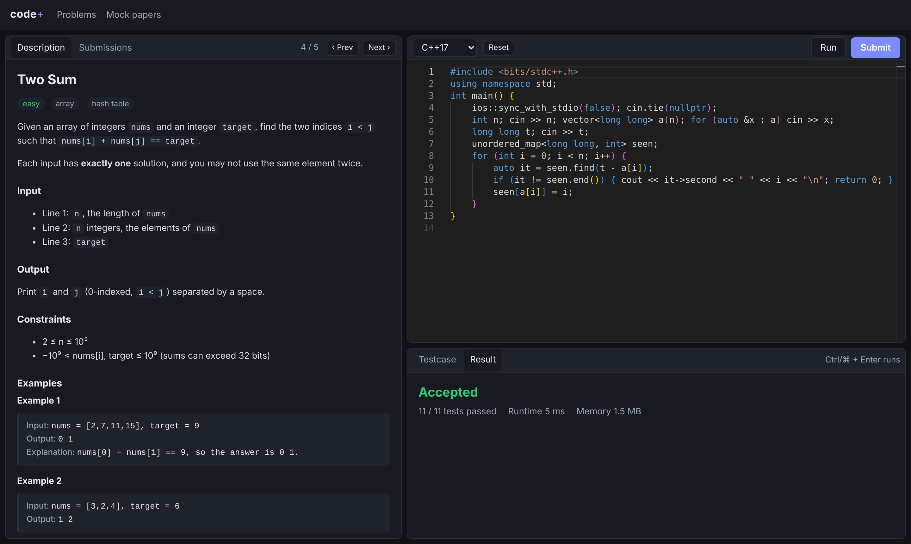
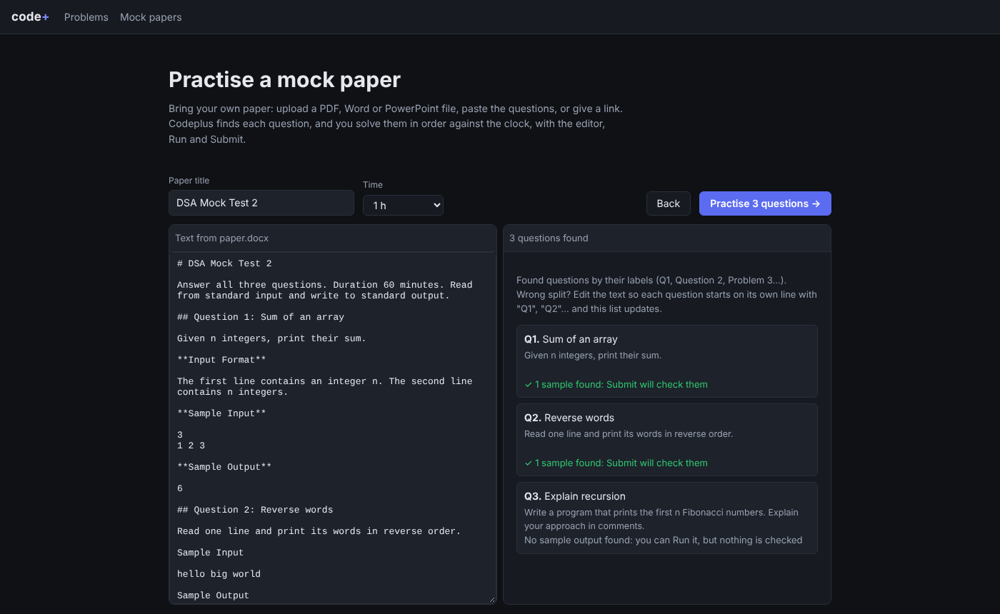
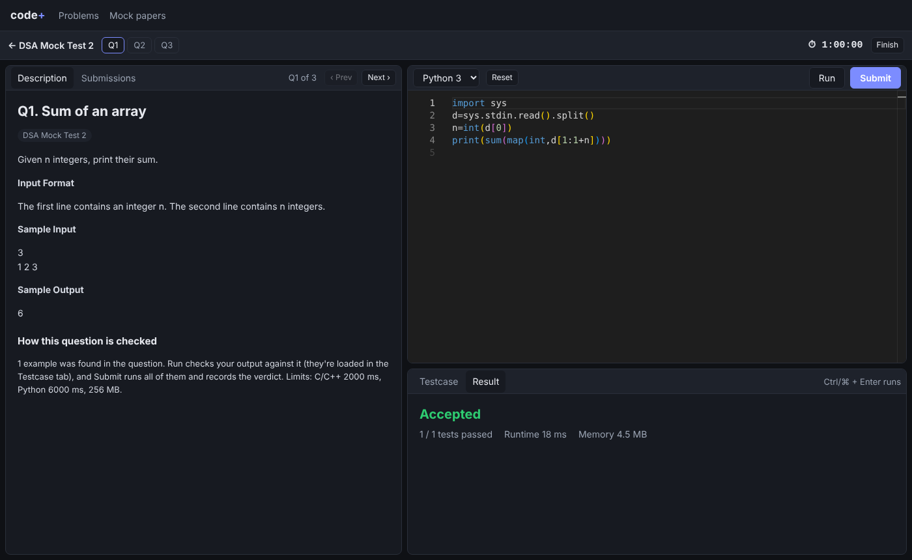
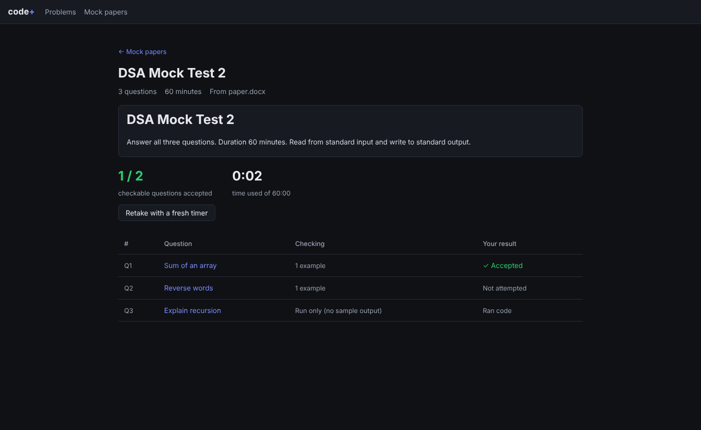
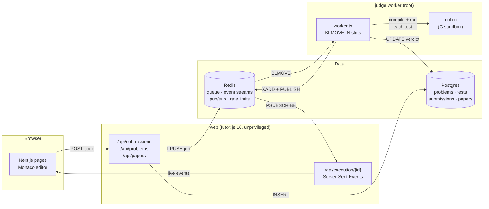

<div align="center">

# code+ &nbsp;·&nbsp; Codeplus

**A self-hosted competitive-programming judge with its own Linux sandbox, written from scratch in C.**

Solve problems in C++, C or Python in a Monaco editor, watch each test case finish live, and practise your own mock papers under exam conditions. Every submission is compiled and run inside **runbox**, a container-style sandbox built directly on Linux namespaces, OverlayFS, cgroups and seccomp-BPF.

[](https://github.com/Rishicreates20/Runbox_22026/actions/workflows/ci.yml)


[](LICENSE)

</div>



## Highlights

- **Hand-written sandbox (`runbox`, ~1,500 lines of C, zero dependencies).** User, mount, PID, network, IPC, UTS and cgroup namespaces; a per-job OverlayFS root entered with `pivot_root`; cgroup v2 limits with a v1 fallback; a default-deny seccomp-BPF allowlist pinned to x86_64. One JSON verdict per run: `OK / TLE / MLE / RE / SV / OLE / IE`. About 7 ms overhead per run.
- **Compilers are sandboxed too.** C and C++ are compiled inside runbox with a separate gcc image, and the binary is copied out with `openat2(RESOLVE_BENEATH | RESOLVE_NO_SYMLINKS)` so a malicious submission can't trick the judge into reading host files.
- **Live results over SSE.** The judge writes each event to a Redis stream and pub/sub channel in one Lua script. The browser reconnects with `Last-Event-ID` and gets an exact replay, with no gaps or duplicates. Each web process shares one Redis subscriber for all clients.
- **Crash-safe queue.** Workers claim jobs with `BLMOVE` into a per-slot processing list, so a killed worker's jobs go back on the queue at the next start.
- **Typed end to end.** Zod schemas in a shared package validate problem uploads, API requests, queue jobs and SSE events. The event contract is also published as [AsyncAPI 3.0](docs/asyncapi.yaml).
- **Mock-paper mode.** Import a PDF, Word or PowerPoint file, pasted text or a public link. The questions and their sample tests are split out automatically, then you sit the paper with a countdown timer and get a score.
- **Ops-ready.** One-command Docker Compose stack, a one-box Ubuntu installer with systemd units and nginx, and GitHub Actions CI that runs the sandbox and judge tests against a real kernel on every push.

## Screenshots

| Problem list | Mock paper: review the split |
|---|---|
|  |  |
| **Mock paper: exam mode** | **Mock paper: results** |
|  |  |

## Architecture



The web tier is stateless and can scale horizontally. The judge has to run on a Linux host where it can be root, because runbox creates namespaces, mounts and cgroups. Submissions themselves never run as root: inside the sandbox they are uid 65534, mapped to an unprivileged host uid, with no capabilities and no network.

More detail: [docs/architecture.md](docs/architecture.md) (request flow, data model, design decisions) and [docs/runbox.md](docs/runbox.md) (sandbox internals and test results).

## Sandbox security model

| layer | what it stops |
|---|---|
| **User namespace** | Sandbox uid 0–65535 maps to host 100000–165535. The program runs as an unmapped user with no capabilities anywhere on the host. |
| **Mount namespace + OverlayFS + `pivot_root`** | The program sees only a read-only language image plus a throwaway upper layer. The host root is detached, and the upper layer is deleted after every job, so nothing persists between submissions. |
| **PID, IPC, UTS namespaces** | The program can't see or signal other processes. It is PID 2 in its own namespace. |
| **Network namespace + seccomp** | Only a downed loopback interface exists, and `socket()` returns `EACCES`. |
| **cgroups (v2, v1 fallback)** | Memory (no swap), process count and CPU time per job. Fork bombs and memory hogs are contained and reported as verdicts. |
| **seccomp-BPF allowlist** | Anything not on the list kills the process: `mount`, `ptrace`, `unshare`, namespace-creating `clone`, 32-bit `int 0x80` and x32 syscalls. |
| **rlimits + `NO_NEW_PRIVS`** | No core dumps, capped output size and open files, and no privilege gain through setuid binaries. |

Each of these is checked by an automated test in [`tests/run_tests.py`](tests/run_tests.py): 22 checks covering verdicts, escapes and cleanup. See [SECURITY.md](SECURITY.md) for the threat model and how to report a vulnerability.

## Quick start (Docker)

You need a Linux host with Docker, or Docker Desktop with the WSL 2 backend on Windows.

```sh
git clone https://github.com/Rishicreates20/Runbox_22026 codeplus && cd codeplus
cp .env.example .env            # set ADMIN_TOKEN and POSTGRES_PASSWORD
docker compose up -d --build
open http://localhost:3000      # or just visit it in a browser
```

Compose starts Postgres, Redis, a one-shot migrate-and-seed job (5 sample problems), the web app on port 3000 and the judge. The judge container runs `privileged` because the sandbox needs to create namespaces and cgroups. The submissions inside it are still fully sandboxed.

For a bare-metal Ubuntu server, WSL 2 notes, environment variables, backups and upgrades, see **[docs/deploy.md](docs/deploy.md)**.

## Local development

Requirements: Linux (or WSL 2), root for the judge, Node 20+, gcc, Python 3.

```sh
make                                                    # build runbox
sudo scripts/make-rootfs.sh /var/lib/runbox/rootfs     --python "$(command -v python3)"
sudo scripts/make-rootfs.sh /var/lib/runbox/rootfs-gcc --python "$(command -v python3)" --gcc
docker compose -f docker-compose.dev.yml up -d          # Postgres + Redis only
npm install
npm run migrate && npm run seed
sudo -E npm run judge                                   # terminal 1
ADMIN_TOKEN=dev npm run dev                             # terminal 2 -> http://localhost:3000
```

## Tests

| command | what it covers |
|---|---|
| `sudo python3 tests/run_tests.py` | 22 sandbox checks: every verdict, isolation probe, escape attempts, cleanup |
| `npm test` | Zod schemas, output checker, mock-paper splitter |
| `sudo -E npx tsx judge/test/e2e.ts` | 18 end-to-end checks through the real queue and sandbox: AC in all three languages, WA, CE, TLE, MLE, RE, blocked syscalls, CRLF input |
| `npm run typecheck` | TypeScript across all three workspaces |

CI ([`.github/workflows/ci.yml`](.github/workflows/ci.yml)) runs all of these on every push and pull request, builds both Docker images, and runs the sandbox tests inside the judge container too.

## Repository layout

```
.
├── src/, scripts/, tests/   runbox: the sandbox (C), image builder, sandbox tests
├── packages/shared/         Zod schemas, branded ids, output checker, Redis/DB helpers
├── judge/                   worker: queue -> compile -> run tests -> stream events
├── web/                     Next.js 16 app, API routes, SSE endpoint
├── db/schema.sql            Postgres schema (idempotent)
├── problems/                seed problems (JSON) and their generator
├── deploy/                  Ubuntu installer, systemd units, nginx config
├── docker/                  container entrypoint for the judge
├── docs/                    architecture, sandbox internals, deploy guide, AsyncAPI spec
├── Dockerfile               multi-stage: `web` and `judge` targets
└── docker-compose.yml       full stack
```

## Tech stack

| area | choice |
|---|---|
| Sandbox | C11, Linux namespaces, OverlayFS, cgroups v2/v1, seccomp-BPF (raw BPF, no libseccomp) |
| Backend | Node.js 22, TypeScript, Zod 4, ioredis, postgres.js |
| Frontend | Next.js 16 (App Router), React 19, Monaco editor (self-hosted), react-markdown |
| Data | PostgreSQL 16, Redis 7 (queue, streams, pub/sub) |
| Ops | Docker multi-stage builds, Docker Compose, systemd, nginx, GitHub Actions |

## Status and known limitations

This is a working project, not a hosted product yet. Being upfront about what isn't done:

- **No user accounts.** Submissions and mock papers are tied to an anonymous browser cookie. Anyone with a paper's link can open it.
- **Languages:** C++17, C11 and Python 3. Java isn't offered yet because the seccomp allowlist hasn't been tuned for the JVM.
- **cgroup v2:** the development host only had cgroup v1, so the limits were first verified through runbox's v1 fallback. CI now runs the full sandbox suite on GitHub's cgroup v2 runners with `--cgroup v2`.
- **x86_64 only.** The seccomp filter is pinned to the x86_64 syscall ABI.
- **Mock papers** use default limits (2 s for C/C++, 6 s for Python, 256 MB) and are checked only against the sample cases found in the text. Scanned PDFs without a text layer can't be read.
- **No live deployment yet.** The judge needs a Linux VPS where it can run as root, so it can't go on serverless platforms.

## License

[MIT](LICENSE)
