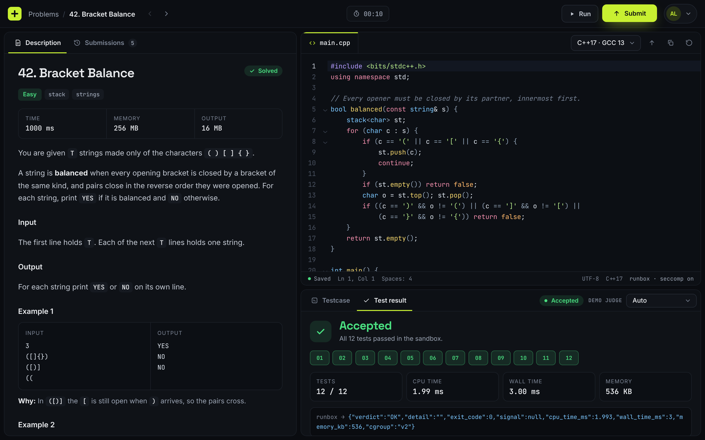
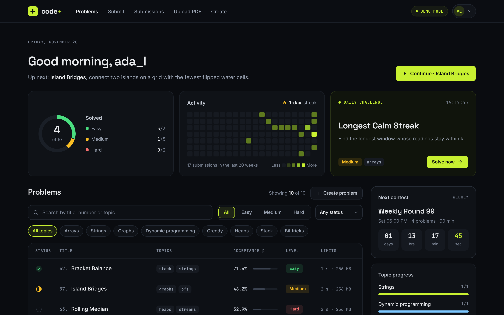
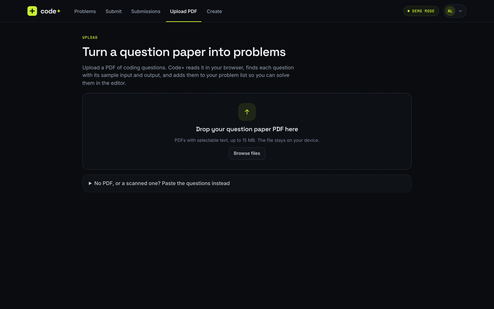
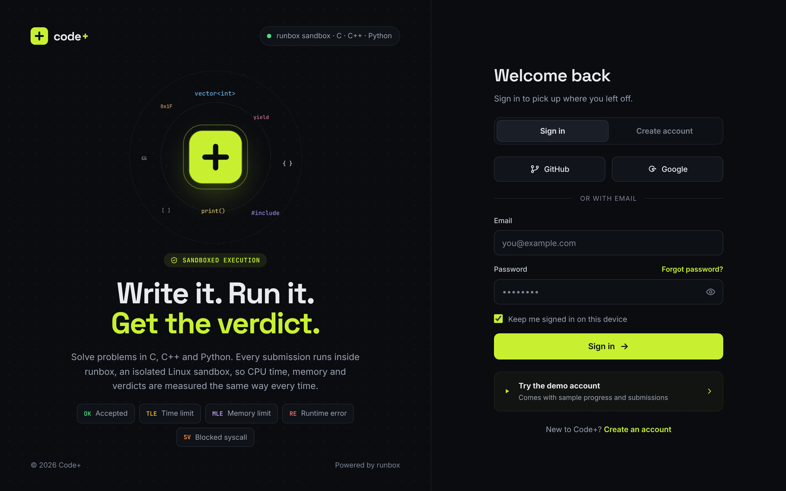
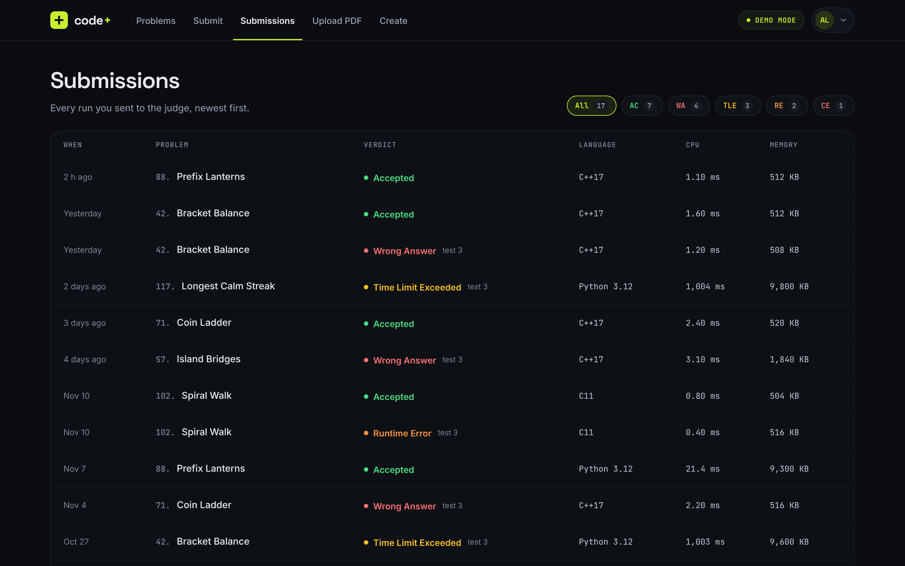
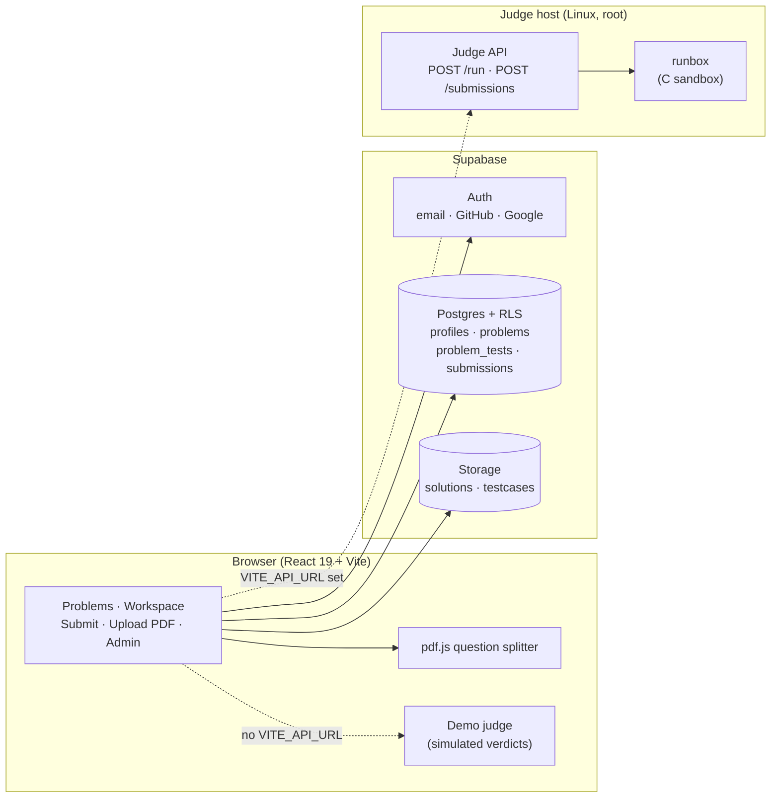

<div align="center">

# code+

**A competitive-programming platform with its own Linux sandbox, written from scratch in C.**

Code+ is a React app for solving problems in C++, C and Python: sign in, pick a problem, write code in the browser and watch each test case get a verdict. It also reads a PDF of coding questions and turns them into practice problems. Submissions are meant to run inside **runbox**, a container-style sandbox built directly on Linux namespaces, OverlayFS, cgroups and seccomp-BPF.

[](https://github.com/Rishicreates20/Runbox_22026/actions/workflows/ci.yml)


[](LICENSE)

</div>



## Highlights

- **Hand-written sandbox (`runbox`, ~1,500 lines of C, zero dependencies).** User, mount, PID, network, IPC, UTS and cgroup namespaces; a per-job OverlayFS root entered with `pivot_root`; cgroup v2 limits with a v1 fallback; a default-deny seccomp-BPF allowlist pinned to x86_64. One JSON verdict per run (`OK / TLE / MLE / RE / SV / OLE / IE`) with about 7 ms of overhead. 22 automated checks cover every verdict, escape attempts and cleanup, and run in CI on every push.
- **Compilers are sandboxed too.** C and C++ can be compiled inside runbox with a separate gcc image, and the binary is copied out with `openat2(RESOLVE_BENEATH | RESOLVE_NO_SYMLINKS | RESOLVE_NO_XDEV)`, so a submission can't trick the host into reading its files.
- **Real accounts with row-level security.** Supabase handles email/password and OAuth sign-in, Postgres tables for problems, hidden tests and submissions, and private storage buckets. RLS policies limit each user to their own submissions and files; only admins can create problems or read hidden tests.
- **A workspace built for practice.** CodeMirror 6 editor with per-problem drafts, resizable panels, editable sample cases, test-by-test results, keyboard shortcuts, and a dashboard with a solved ring, activity heatmap and streaks.
- **PDF question import, all in the browser.** A question paper is parsed with pdf.js, split into problems, and each one's statement, I/O format, constraints and samples are pulled out for review. No server sees the file.
- **Three backends, chosen by environment.** Supabase for real accounts, a documented REST contract for a custom judge server, or a zero-config demo mode that runs entirely in `localStorage`.
- **Ops-ready.** A multi-target Dockerfile (unprivileged nginx for the app, a privileged image for the sandbox), Vercel config, and GitHub Actions that typecheck and build the app, run the sandbox tests on a real cgroup v2 kernel, and build and test both images.

## Screenshots

| Problem dashboard | PDF question import |
|---|---|
|  |  |
| **Sign in** | **Submission history** |
|  |  |

Screenshots are from demo mode (`DEMO MODE` badge), where verdicts come from the in-browser judge simulator described below.

## Architecture



The app is a static site, so it can be hosted anywhere (Vercel, nginx, any CDN). Accounts and data live in Supabase. Judging goes either to the in-browser simulator or, when `VITE_API_URL` is set, to a judge server that runs each test through runbox. The request and response shapes for that server are specified in [web/README.md](web/README.md#custom-api), and `JudgeReport.raw` is runbox's own JSON, passed through unchanged.

## Sandbox security model

| layer | what it stops |
|---|---|
| **User namespace** | Sandbox uid 0–65535 maps to host 100000–165535. The program runs as an unmapped user with no capabilities anywhere on the host. |
| **Mount namespace + OverlayFS + `pivot_root`** | The program sees only a read-only language image plus a throwaway upper layer. The host root is detached, and the upper layer is deleted after every job. |
| **PID, IPC, UTS namespaces** | The program can't see or signal other processes. It is PID 2 in its own namespace. |
| **Network namespace + seccomp** | Only a downed loopback interface exists, and `socket()` returns `EACCES`. |
| **cgroups (v2, v1 fallback)** | Memory (no swap), process count and CPU time per job. Fork bombs and memory hogs are contained and reported as verdicts. |
| **seccomp-BPF allowlist** | Anything not on the list kills the process: `mount`, `ptrace`, `unshare`, namespace-creating `clone`, 32-bit `int 0x80` and x32 syscalls. |
| **rlimits + `NO_NEW_PRIVS`** | No core dumps, capped output size and open files, and no privilege gain through setuid binaries. |

Each layer is checked by [`tests/run_tests.py`](tests/run_tests.py). Internals, design decisions and measured results are in [docs/runbox.md](docs/runbox.md); the threat model is in [SECURITY.md](SECURITY.md).

## Quick start

**The app, in demo mode** (no accounts or backend needed; Node 20.19+ or 22.12+):

```sh
git clone https://github.com/Rishicreates20/Runbox_22026 codeplus && cd codeplus/web
npm install
npm run dev            # http://localhost:5173, then "Try the demo account"
```

Or with Docker: `docker build --target web -t codeplus-web . && docker run -p 8080:8080 codeplus-web`.

**With real accounts:** copy `web/.env.example` to `web/.env.local`, fill in `VITE_SUPABASE_URL` and `VITE_SUPABASE_ANON_KEY`, and apply [`supabase/migrations`](supabase/migrations). See [docs/deploy.md](docs/deploy.md#2-supabase-real-accounts).

**The sandbox** (Linux x86_64, root):

```sh
make
sudo scripts/make-rootfs.sh /var/lib/runbox/rootfs     --python /usr/bin/python3
sudo scripts/make-rootfs.sh /var/lib/runbox/rootfs-gcc --python /usr/bin/python3 --gcc
sudo python3 tests/run_tests.py                        # 22/22
```

Or in a container: `docker build --target runbox -t codeplus-runbox . && docker run --rm --privileged --cgroupns private --tmpfs /tmp/runbox codeplus-runbox`.

## Tests and CI

| command | what it covers |
|---|---|
| `sudo python3 tests/run_tests.py` | 22 sandbox checks: every verdict, isolation probe, escape attempts, `--export` symlink attack, cleanup |
| `cd web && npm run typecheck` | TypeScript across the app |
| `cd web && npm run build` | Production build (also `build:static` for sub-path hosting) |

[`.github/workflows/ci.yml`](.github/workflows/ci.yml) runs all of these on every push and pull request, with the sandbox suite run twice: on GitHub's Ubuntu 24.04 runners with `--cgroup v2`, and inside the Docker image. It also smoke-tests the nginx image's client-side routing.

## Repository layout

```
.
├── src/                runbox: the sandbox (C)
├── scripts/            sandbox image builder (Python and gcc images)
├── tests/              sandbox test suite and the hostile programs it runs
├── web/                Code+ React app (Vite, React Router, CodeMirror, Supabase client)
├── supabase/           Postgres schema, RLS policies and storage buckets as migrations
├── docker/             nginx config and the sandbox container entrypoint
├── docs/               sandbox internals, deploy guide, screenshots
├── Dockerfile          `web` and `runbox` targets
└── .github/workflows/  CI
```

## Tech stack

| area | choice |
|---|---|
| Sandbox | C11, Linux namespaces, OverlayFS, cgroups v2/v1, seccomp-BPF (raw BPF, no libseccomp) |
| Frontend | React 19, TypeScript, Vite, React Router 7, CodeMirror 6, pdf.js (unpdf), fflate |
| Backend services | Supabase: Auth, Postgres with row-level security, Storage |
| Ops | Docker multi-stage builds, nginx (unprivileged), Vercel, GitHub Actions |

## Status and known limitations

This is a working project, not a hosted product yet. Being upfront about what isn't done:

- **The sandbox isn't wired to the app yet.** runbox is complete and tested on its own, and the app has a client for a judge API, but the server between them (queue, workers, test storage) isn't in this repo. Until one is deployed, verdicts in the app come from the in-browser simulator and don't prove a solution is correct. The app labels this `DEMO JUDGE`.
- **Languages:** C++17, C11 and Python 3. Java isn't offered because the seccomp allowlist hasn't been tuned for the JVM.
- **x86_64 only.** The seccomp filter is pinned to the x86_64 syscall ABI.
- **PDF import** needs a text layer; scanned PDFs can't be read (pasting the text works).
- **Email confirmation** on Supabase's built-in mailer only reaches the project's own team. Public sign-ups need a custom SMTP server or confirmation switched off.

## License

[MIT](LICENSE)
