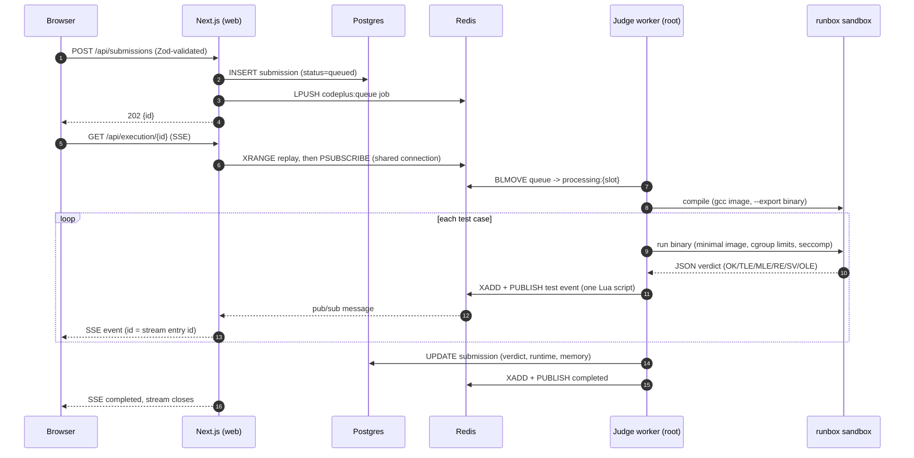

# Architecture

This page is the deep dive. For the overview, quick start and screenshots see the [README](../README.md); for the sandbox internals see [runbox.md](runbox.md); for operations see [deploy.md](deploy.md).

## Request flow

## Data model

`db/schema.sql` defines four tables:

| table | holds |
|---|---|
| `problems` | slug, title, markdown statement, limits per language, starter code, tags, `paper_id` for mock-paper questions (kept out of the public list) |
| `test_cases` | raw `input` (stdin, LF-normalised), `display_input`, expected output, `is_sample` |
| `papers` | an imported mock paper: title, source, time limit, owning browser |
| `submissions` | anonymous client id, language, code, mode (run/submit), verdict, tests passed, runtime, memory, timestamps |

Redis holds the job queue (`codeplus:queue` plus one processing list per worker slot), a stream per submission with a one-hour TTL, the `codeplus:exec:*` pub/sub channels and the rate-limit counters. Nothing in Redis is needed after a submission completes, but the queue matters while jobs wait, so the Compose stack turns on the append-only file.

## Design notes, component by component

**Monaco in Next.js.** The editor component is loaded with `next/dynamic(..., { ssr: false })`, so the statement, examples and limits are server-rendered and the editor mounts only in the browser. The editor and Monaco instances live in `useRef`s, and switching language calls `monaco.editor.setModelLanguage` on the existing model instead of re-creating the editor. Monaco is self-hosted: `web/scripts/copy-monaco.mjs` copies monaco-editor's prebuilt bundle to `public/monaco/vs` before `dev`/`build`, and the loader is pointed there. The editor and its web workers therefore load from our own origin and never pass through webpack or Turbopack. That sidesteps the worker-routing, CSS-import and Turbopack problems in the doc without patching Monaco. The app doesn't use Tailwind, so there's no purge step to strip Monaco's classes.

**Problem ingestion (Zod).** `ProblemUpload` is a discriminated union on `problem_type`:

| `problem_type` | test data | refinements |
|---|---|---|
| `generic` | raw `input` + `displayInput` | — |
| `array_manipulation` | `args.target_array`, `args.k_value` | length < 10⁵, ints within ±10⁹, k ≥ 0 |
| `graph_traversal` | `args.adjacency_list`, `args.start_node` | every neighbour and the start node within `0..n-1`, ≤ 10⁶ edges |
| `string_parsing` | `args.input_string`, plus problem-level `input_pattern` | pattern is a valid ECMAScript regex, every string < 10⁴ chars, single line, fully matches the pattern |

All objects are strict, so unknown fields are rejected. A refinement requires Python's time limit to be at least the C/C++ one. Problem slugs and submission ids are branded types. Every test is stored twice: `input` (raw stdin, CRLF → LF, ending in a newline) and `display_input` (what the page shows). For the typed kinds both are produced from `args` by one canonical encoder, so authors never hand-write stdin. On the queue, code and test data are base64.

Upload problem JSON at `/admin` (not linked from the menu) or `POST /api/problems`. `?dryRun=1` validates and previews without saving. Both need `Authorization: Bearer $ADMIN_TOKEN`, because validation runs author-supplied regexes. Every public endpoint reads its body through a size-capped reader (`web/lib/body.ts`), so a chunked request without `Content-Length` can't make the server buffer an unbounded body.

**SSE + Redis.** The judge appends each event to a per-submission Redis stream and publishes it, in one Lua script. The stream entry id is the SSE `id`. `GET /api/execution/{id}`:

- replays from the stream after `Last-Event-ID`, then switches to live pub/sub without gaps or duplicates (it subscribes first and buffers);
- shares one Redis connection per web process: a single `PSUBSCRIBE codeplus:exec:*` fanned out from an in-memory map, not a connection per browser;
- sends `retry: 2000`, a `: heartbeat` every 15 s, and `X-Accel-Buffering: no`;
- drops clients whose socket hasn't drained for 5 s;
- closes after the `completed` event. After the one-hour log TTL it serves the stored result from Postgres.

The contract is in [docs/asyncapi.yaml](docs/asyncapi.yaml). The Zod source of truth is `packages/shared/src/events.ts`.

**Judge.** The worker takes jobs with `BLMOVE` into a per-slot processing list, so a crash puts them back on the queue at the next start. C/C++ is compiled **inside runbox** with a separate image that contains gcc (`make-rootfs.sh --gcc`). The binary comes out through `runbox --export`, which can't be tricked by symlinks, and is then run in the minimal image. Python gets a sandboxed syntax check, so syntax errors are reported as CE rather than RE. Submit stops at the first failing test. Run executes the sample cases, or the custom stdin typed in the console, and only checks inputs that match a sample. The checker ignores trailing spaces and trailing blank lines.

**Mock papers.** `/practice` imports a paper from a PDF, `.docx`, `.pptx` or text file (up to 15 MB), pasted text, or a public link (web page, PDF, or a Google Doc/Slides shared as "anyone with the link"). `POST /api/papers/extract` turns it into text: mammoth + Turndown for DOCX and HTML (headings, lists, code blocks and tables survive), unpdf for PDF, and the slide XML for PPTX. Links are fetched server-side with a DNS check that refuses private, loopback and link-local addresses on every hop, a 20 s timeout and the same 15 MB cap. The browser then splits the text with `splitPaper` (`packages/shared/src/paper.ts`), which finds questions by label (`Q1`, `Question 2`, `Problem C`, `Task 3`…), else by repeated headings, a top-level numbered list or slide breaks. It also pulls out `Sample Input`/`Sample Output` (or `Input:`/`Output:`) pairs. The user reviews the split, can edit the text (the list updates live), picks a time, and saves. Each question becomes a `problems` row with `paper_id` set, its examples become sample tests, and it's kept out of the public list. Questions with examples get Run and Submit checked against them; questions without any are run-only (Submit is off and the API refuses it). The timer runs in the browser: an exam bar with Q chips, a countdown, Finish, and a time's-up dialog, and the paper page shows the score afterwards. Every problem page, paper or not, has Prev/Next.
